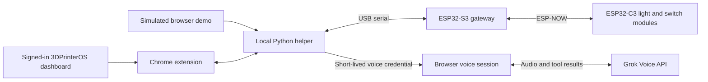

# Printability

**Find the right 3D printer, understand its availability, and locate it on the floor.**

Printability is a HackGT 13 prototype for people using shared 3D-printing spaces. It combines a Chrome extension for 3DPrinterOS, optional conversational guidance, and physical status lights so users can choose a suitable printer without having to interpret a whole printer farm themselves.

[Try the interactive demo](https://printability.tech) · [Read the project story](https://devpost.com/software/printability) · [Hardware setup](firmware/README.md)

> The public demo uses simulated printers. The extension reads a signed-in 3DPrinterOS dashboard. Both can connect to the local hardware helper. Printability prepares a review; it does **not** start a print.

## What it does

- **Find a printer:** filter by material and color, then identify matching idle printers. Matching checks a single loaded filament slot, rather than combining a material from one slot with a color from another.
- **Show availability:** display reported status and remaining print time, distinguish unknown waits, and exclude printers marked out of service. Stored files are not treated as a scheduled queue.
- **Inspect existing files:** browse searchable printer files and, when requested, open available file details or Slice Info to read the requirements exposed by the dashboard.
- **Prepare a review:** assemble a review card for a selected file and printer, including material matching and manual checks for the plate, nozzle, filament, and physical readiness. Printing remains disabled in Printability.
- **Ask Printability Voice:** use Grok Voice to find a matching printer, inspect a requested file, prepare its review, or highlight a machine. Voice is optional; printer matching and status colors use local rules.
- **Connect the screen to the room:** optional RGB light modules show printer state, flash to identify a selected machine, and report physical out-of-service switches back to the dashboard.

## Two ways to try it

### 1. Explore the demo

Open **[printability.tech](https://printability.tech)**. If the custom domain is unavailable, use the [GitHub Pages address](https://franklin-yuan.github.io/printability/).

The demo runs without an account, extension, API key, or hardware. Explore the sample printer farm, change printer states, and try material/color matching. Without a configured local helper, voice interactions use a clearly labeled scripted sample rather than a live AI conversation.

To serve the demo locally from the repository root:

```sh
python -m http.server 8000
```

Then open `http://localhost:8000/demo/`.

### 2. Use the extension with 3DPrinterOS

1. Clone or download this repository.
2. In Chrome, open `chrome://extensions` and enable **Developer mode**.
3. Choose **Load unpacked** and select the [`extension/`](extension/) directory.
4. Open [3DPrinterOS](https://cloud.3dprinteros.com/#/printers), sign in normally, and load the Printers dashboard.
5. Use Printability's **Find a printer**, **Matching**, and **Settings** views.

Basic matching works without the helper. After changing extension files, reload the extension and refresh the dashboard. Use the files in `extension/`; similarly named JavaScript files at the repository root are not the extension entry point.

## Optional local helper

The Python helper connects the browser to USB hardware and creates short-lived credentials for live voice sessions. The current helper is intended for a **Windows workstation with Python 3 and Tkinter**. It listens on `127.0.0.1:8765`.

Start it from the repository root:

```sh
python helper/printy_helper.py
```

Alternatively, open `helper/Printability.pyw` with Python. The included `Start Printability.vbs` shortcut expects Python at `C:\Program Files\Python312\pythonw.exe`; use the command above if Python is installed elsewhere.

To pair the extension:

1. Open the extension's connection settings and copy its extension ID into the helper.
2. Click **Save connection**.
3. In the helper, click **Copy connection code**. Paste it into the extension connection settings and test the connection.
4. Leave the helper running while using lights or live voice.

For USB lights, select the ESP32-S3 serial port and click **Connect**. PySerial is bundled under `helper/vendor/`; `helper/requirements.txt` also specifies `pyserial==3.5` if a separate installation is needed.

### Live voice

Enter an **xAI API key** in the helper, save the connection, then explicitly start Printability Voice in the extension. Microphone permission and access to xAI's realtime voice API are required; live voice usage is billed to your xAI account.

The helper requests an ephemeral client secret, and the browser connects to Grok Voice over WebSocket. The current implementation does not use OpenAI for voice or analysis. The long-lived API key is not entered into the extension.

### Demo with real lights or live voice

Open the demo on the **same computer** as the helper. Pair it with the helper connection code, or explicitly enable **Allow booth demo page** in the helper, then choose **Connect lights** in the demo. The booth option lets the allowed demo origins use the local lights and request live voice credentials without pasting the connection code.

Turning on the helper alone does not turn the simulated demo into a live 3DPrinterOS feed. Close or disconnect other controlling tabs if the helper reports that another tab owns the lights.

## How it fits together



| Component | Role |
| --- | --- |
| [`extension/`](extension/) | Manifest V3 extension, dashboard readers, matching rules, file review, voice interface, and printer highlighting. |
| [`extension/logic.js`](extension/logic.js) | Shared deterministic status, filament matching, availability, and light-command logic. Also used by the demo. |
| [`demo/`](demo/) | Standalone simulated printer farm with optional local lights and live voice. |
| [`helper/`](helper/) | Windows GUI, loopback HTTP bridge, xAI voice-token requests, and USB serial connection. |
| [`firmware/`](firmware/) | ESP32-S3 gateway and ESP32-C3 module firmware. |
| [`.github/workflows/pages.yml`](.github/workflows/pages.yml) | Publishes the standalone demo to GitHub Pages. |

## Physical status lights

The current firmware uses an **ESP32-S3 USB gateway** and **ESP32-C3 wireless modules**. Each C3 drives its own eight-pixel WS2812 strip and reads its own switch. The S3 relays commands and switch reports; it does not directly drive a daisy-chained LED strip.

- C3 switch: **GPIO4 to GND**; closed means out of service.
- C3 LED data: **GPIO2**.
- Each module has a fixed `MODULE_ID`, set before flashing.
- Firmware and helper support IDs **1–6**, using protocol version **4**.

See the [firmware guide](firmware/README.md) for power, wiring, dependencies, and flashing instructions.

| Color / behavior | Meaning in the current browser rules |
| --- | --- |
| Green | Available or finished; check the displayed status and clear the bed. |
| Blue | Printing, heating, or preparing. |
| Amber | Paused. |
| Red | Error or out-of-service override. |
| Purple | Offline or unknown. |
| Off | No unique printer assigned to that light. |
| Flashing | Selected printer highlighted for identification. |

## Current boundaries

Printability is a working prototype, not a replacement for the printer dashboard or an autonomous print operator.

- **No print execution:** the extension rejects print-commit requests. Users must inspect the machine and use the native dashboard to start a job. Printability does not upload or slice models, change printer settings, or resume/cancel jobs.
- **Dashboard-dependent data:** the extension reads information exposed by the loaded 3DPrinterOS UI. Hidden, unloaded, stale, or unreadable data can remain unknown, and dashboard changes may break the readers.
- **Approximate matching:** color names are inferred from visible swatches. A material match does not establish nozzle compatibility, safe slicing settings, sufficient filament, or a clear bed.
- **Reported time, not a queue forecast:** the current shared `waitEstimate()` uses reported remaining time. Although a collection-buffer setting exists, that function does not currently apply it. Missing estimates and unavailable printers do not receive invented wait times.
- **Light-count mismatch:** firmware and helper support six modules, but the current shared `lightCommands()` caps generated commands at five. The sixth channel needs that mismatch resolved before relying on it end to end.
- **Hardware effect limits:** browser code describes additional light effects, but the current helper/firmware path forwards RGB and a binary flash flag. Those effects and progress-fill visuals are not all implemented end to end.
- **Local prototype hardware:** ESP-NOW uses unencrypted broadcast packets. The helper and firmware are intended for a trusted local demonstration, not a networked production fleet.

## Voice and local data

The helper keeps the xAI key outside the repository and uses Windows DPAPI for saved connection settings. If encrypted saving fails, the GUI reports that the connection is available only for that session. Extension pairing uses a separate connection code.

Live voice sends microphone audio and relevant dashboard/tool results to xAI. Treat printer names, filenames, and spoken requests as information that may be shared with that provider. No key or paid voice session is needed for the simulated demo, basic matching, or hardware-only operation.

## Project context

Built for **HackGT 13** around the needs of shared makerspaces, including Georgia Tech's Invention Studio. The [Devpost write-up](https://devpost.com/software/printability) explains the motivation and longer-term vision; this README describes the implementation currently in this repository.
